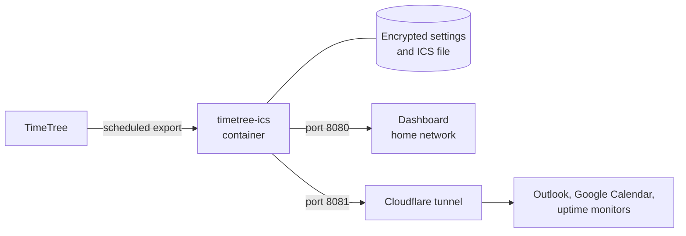

<div align="center">

# TimeTree ICS

**Subscribe to your TimeTree calendar in Outlook, Google Calendar and Apple Calendar.**

A self-hosted Docker service that exports a TimeTree calendar on a schedule and publishes it<br>
as a private ICS feed, managed from a web dashboard.

[](https://github.com/storkakos/timetree-ics/releases)
[](LICENSE)
[](https://www.python.org/)
[](docker-compose.yml)
[](#sharing-through-a-cloudflare-tunnel)

[Features](#features) ·
[Quick start](#quick-start) ·
[Subscribing](#subscribing-to-the-calendar) ·
[Tunnel](#sharing-through-a-cloudflare-tunnel) ·
[Configuration](#configuration) ·
[Security](#security-model)

</div>

---

## Features

| | |
|---|---|
| **Scheduled export** | Syncs one TimeTree calendar every 0.5 to 24 hours (default: 3 hours). |
| **Private ICS feed** | Serves the calendar under a secret token URL. The token can be replaced at any time. |
| **Web dashboard** | Shows sync status and upcoming events. A **Sync now** button runs an export on demand. |
| **Settings in one place** | Sign-in, calendar selection, sync interval, feed token and tunnel are managed in the browser. |
| **Cloudflare tunnel** | Optional built-in tunnel that exposes nothing, the ICS feed only, or a read-only dashboard. |
| **Encrypted settings** | Credentials and tokens are stored encrypted, with the key on a separate volume. |
| **Standards-compliant output** | Repairs the exporter's all-day dates and time zones, so strict calendar clients accept the feed. |
| **Uptime monitoring** | A `/ping` endpoint for tools such as Uptime Kuma. |
| **Small footprint** | Alpine-based image that runs as a non-root user. No database. |

## How it works



Port 8080 serves the full dashboard and should stay on your home network. Port 8081 is the public side: the
application decides what is reachable there, regardless of how the tunnel is configured in Cloudflare.

## Quick start

**Requirements:** Docker with Compose, and a TimeTree account with an e-mail address and password. Accounts that
only sign in through Google or Apple have no password and are not supported.

```bash
git clone https://github.com/storkakos/timetree-ics.git
cd timetree-ics
docker compose up -d --build
```

Open `http://<host>:8080` and go to **Settings**:

1. **TimeTree account:** enter your e-mail and password, then select *Sign in & load calendars*.
2. **Calendar & sync:** choose the calendar and interval, tick *Sync immediately afterwards*, and save.
3. **ICS URL:** copy the URL and add it to your calendar app.

No credentials are placed in `docker-compose.yml` or `.env`.

## Subscribing to the calendar

| App | Where to add the URL |
|---|---|
| **Outlook** | *Add calendar → Subscribe from web* |
| **Google Calendar** | *Other calendars → From URL* |

> [!IMPORTANT]
> Outlook on the web, Microsoft 365 and Google Calendar fetch the feed from their own servers. The URL must be
> publicly reachable over HTTPS, for example through the [Cloudflare tunnel](#sharing-through-a-cloudflare-tunnel).

The sync interval controls how fresh the ICS file is. Your calendar app decides how often it fetches the file,
which is typically every few hours, so changes can take some time to appear.

## Sharing through a Cloudflare tunnel

The tunnel is optional and runs inside the container.

1. In Cloudflare Zero Trust, go to *Networks → Tunnels → Create a tunnel → Cloudflared* and copy the **token**.
   You can also copy the whole install command, and the app extracts the token.
2. Add a **Public Hostname** to the tunnel with the service `HTTP` and `localhost:8081`.
3. In the app, open **Settings → Sharing via Cloudflare tunnel**, paste the token, tick *Tunnel enabled*, choose
   a mode and enter the public hostname. The hostname is only used to display the public ICS URL.

### Exposure modes

| Mode | Reachable through the tunnel |
|---|---|
| **Nothing** (default) | `/ping` only |
| **ICS file only** | `/calendar.ics?token=…` and `/ping` |
| **Dashboard (read-only) + ICS** | Status and upcoming events, the ICS feed and `/ping` |

Settings and **Sync now** are never reachable through the tunnel. The public dashboard also hides the ICS URL and
token. The mode is enforced by the application on port 8081, and for any request that carries Cloudflare headers.

> [!WARNING]
> The dashboard has no login of its own. If you expose it, protect the hostname with a Cloudflare Zero Trust
> **Access policy**, or keep it on your home network.

### Using an existing cloudflared

If `cloudflared` already runs elsewhere, for example in Uptime Kuma, leave the built-in tunnel disabled and point
its public hostname at `http://timetree-ics:8081` on the same Docker network.

## Monitoring

Point your monitor at `https://<hostname>/ping`. The endpoint is available in every mode, needs no token and only
returns `pong`.

> [!NOTE]
> `/ping` shows that the service and the tunnel are up, not whether the last sync succeeded.

## Configuration

Host settings go into a `.env` file next to `docker-compose.yml`. Apply changes with `docker compose up -d`:

```bash
PORT=8090
TZ=Europe/London
```

| Variable | Default | Purpose |
|---|---|---|
| `PORT` | `8080` | Host port of the dashboard. |
| `TZ` | `Europe/Berlin` | Time zone name for dashboard times. An invalid name falls back to UTC. Event times in the feed are not affected. |
| `SECRET_KEY` | – | Fernet key that overrides the key file. See [`.env.example`](.env.example). |
| `SECRET_KEY_FILE` | `/secrets/secret.key` | Location of the key file. |
| `DATA_DIR` | `/data` | Data directory. |
| `PUBLIC_PORT` | `8081` | Port treated as public, where the tunnel points. |
| `CLOUDFLARED_TAG` (build argument) | `2026.10.7` | Version of the `cloudflared` image to copy the binary from. |

The host port cannot be changed in the dashboard. Port mappings belong to Docker on the host, and giving the app
access to the Docker socket would be a security risk. The app keeps using ports 8080 and 8081 inside the container,
so a tunnel is not affected by a changed host port.

## Security model

- All settings, including the TimeTree credentials, ICS token and tunnel token, are stored in `/data/settings.enc`,
  encrypted with Fernet (AES-128-CBC with HMAC-SHA256).
- The key is generated on first start and stored in `/secrets/secret.key`, on a **separate volume**.
- Secrets are never shown in the UI, never written to logs, and reach child processes only through their environment.
- The ICS file contains your event titles and is stored unencrypted, because it has to be served.
- Anyone with both volumes, or with shell access to the running container, can decrypt the settings. The TimeTree
  password has to be recoverable to log in.
- If the key is lost, the settings have to be entered again.

## Data and upgrades

| Volume | Mount | Content |
|---|---|---|
| `timetree-data` | `/data` | `settings.enc`, `timetree.ics`, `state.json` |
| `timetree-secrets` | `/secrets` | `secret.key` |

Back up the two volumes separately, so that the encrypted settings and their key are not stored together.

To upgrade:

```bash
git pull
docker compose up -d --build
```

Named volumes let the non-root container user (uid 1000) write. If you switch to bind mounts, run
`chown 1000:1000` on the host folders.

## Development

```bash
python -m venv .venv && . .venv/bin/activate
pip install -r requirements.txt
python tests/smoke_test.py
docker exec -i timetree-ics python - < tests/port_check.py
```

| Test | Requirements | Covers |
|---|---|---|
| `tests/smoke_test.py` | Linux | Encryption, settings, exposure modes, ICS repair and tunnel handling. TimeTree and `cloudflared` are mocked. |
| `tests/port_check.py` | Running container, mode *Nothing* or *ICS file only* | Internal and public port detection against real gunicorn. |

Both print `ALL OK` on success. [`AGENT.md`](AGENT.md) contains the specification, the design decisions and the
verification status.

### Branches and releases

| Branch | Purpose |
|---|---|
| `main` | Released versions only. Every release is a tagged commit. |
| `dev` | Integration branch. All work starts here, and pull requests target it. |

Versions follow [Semantic Versioning](https://semver.org/). To release, record the changes in
[`CHANGELOG.md`](CHANGELOG.md), merge `dev` into `main` with a pull request, and tag the result, for example `v0.9.1`.

## Limitations

- TimeTree has no official API for this. The service uses an unofficial web API through
  [`timetree-exporter`](https://github.com/eoleedi/TimeTree-Exporter), which can break or rate-limit without notice.
- Only one calendar is exported at a time.
- Only accounts with an e-mail address and password are supported.
- A subscribed calendar shows all events in one color. TimeTree label colors are not exported.

## Credits

- [eoleedi/TimeTree-Exporter](https://github.com/eoleedi/TimeTree-Exporter) (MIT): the exporter used under the hood.
- [cloudflare/cloudflared](https://github.com/cloudflare/cloudflared): the tunnel client.
- Inspired by [gottfried1980/timetable-docker](https://github.com/gottfried1980/timetable-docker) and
  [Poeschl/docker-timetree-exporter](https://github.com/Poeschl/docker-timetree-exporter). No code from them is used.

## License

Released under the [MIT License](LICENSE).

TimeTree is a trademark of its owner. This project is not affiliated with or endorsed by TimeTree, Inc.
