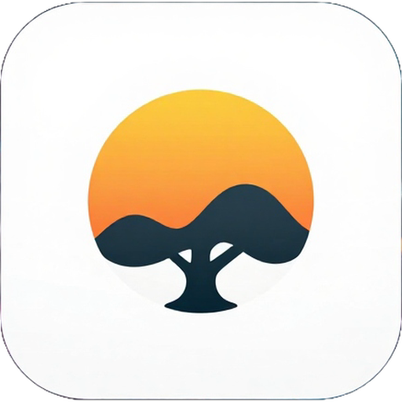
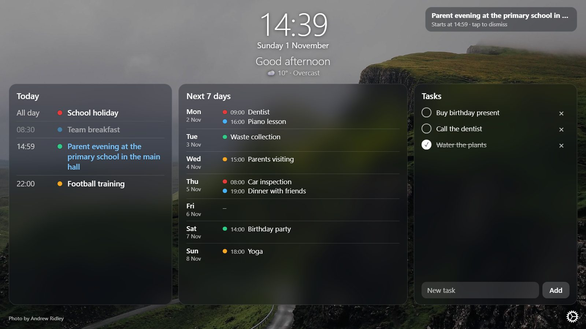
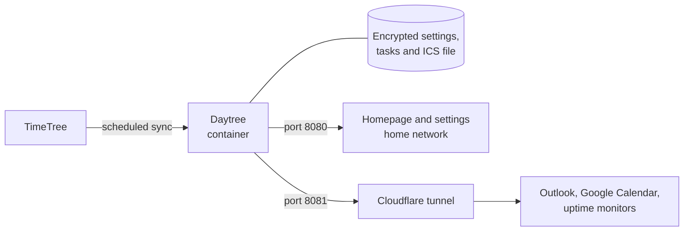

<div align="center">



# Daytree

**Your family's day at a glance, on any screen.**

A self-hosted home calendar app for TVs, monitors, tablets and phones, powered by your TimeTree calendar.<br>
With tasks, reminders, a weather forecast, waste collection and beautiful photo backgrounds.

[](https://github.com/storkakos/daytree/releases)
[](LICENSE)
[](https://www.python.org/)
[](docker-compose.yml)

[Features](#features) ·
[Quick start](#quick-start) ·
[Wall display](#setting-up-a-wall-display) ·
[Calendar apps](#subscribing-from-calendar-apps) ·
[Remote access](#remote-access-with-cloudflare) ·
[Security](#security)

<br>



</div>

> [!NOTE]
> Daytree is in beta. It uses an unofficial TimeTree web API, which can change without notice.

## Why Daytree?

TimeTree is a great shared calendar, but it lives on your phone. Daytree puts it on the wall: a calm, always-on
display that shows the whole household what is happening today and this week. It runs on your own server, needs no
extra account, and also keeps your calendar in sync with Outlook and Google Calendar.

## Features

### For everyday use

- **Today and the next 7 days:** recurring events included, each with its TimeTree color.
- **Tasks:** add, tick off and delete household tasks directly on a tablet. You can hide them if you don't need them.
- **Reminders:** a notice appears 30 minutes before an event starts.
- **Weather and greeting:** current weather for your town and a personal greeting. No API key needed.
- **Weather forecast:** the next 10 hours or 7 days, with day and night icons.
- **Waste collection:** upload an ICS file, pick a color per collection and see small bins next to the days, if you
  like one day early as a reminder to put them out.
- **Works on any screen:** landscape on a TV, portrait on a monitor or tablet, and a scrolling layout on phones.
  Panels adapt to their content, so a quiet day leaves more room for the week ahead.
- **Always up to date:** an open page picks up changed settings and app updates by itself.

### Make it yours

Everything is behind the gear icon, saved immediately and shown live:

- **Background:** changing photos or a solid color, with your own interval in minutes, blur and brightness controls.
- **Clock and date:** digital or analog, 12 or 24 hours, seconds, size, time zone and date style.
- **Font:** family, size and weight.
- **Language:** German and English, following your browser or set by you.

### Under the hood

- **Calendar sync:** imports one TimeTree calendar every 0.5 to 24 hours (default: 3 hours).
- **Private ICS feed:** subscribe from Outlook, Google Calendar or Apple Calendar through a secret URL.
- **Remote access:** an optional built-in Cloudflare tunnel. You choose what it shares: the ICS feed, the homepage,
  the API, or any mix.
- **Privacy:** credentials, tokens, tasks and the waste calendar are stored encrypted. No database, no cloud service of ours.
- **Settings padlock:** an optional password for the settings, while the homepage stays open.
- **Monitoring:** a `/ping` endpoint for tools such as Uptime Kuma, a note on the homepage when its events are out
  of date, and a message to ntfy or a webhook when syncing stops working.
- **API:** a JSON API for calendars, events and tasks, with tokens you create and revoke in the settings.
- **Small footprint:** one Alpine-based container that runs as a non-root user.

## Quick start

**You need:** Docker with Compose, and a TimeTree account with an e-mail address and password. Accounts that only sign
in through Google or Apple have no password and are not supported.

```bash
git clone https://github.com/storkakos/daytree.git
cd daytree
docker compose up -d --build
```

Open `http://<host>:8080`. A setup window guides you through the first start:

1. **Sign in** with your TimeTree e-mail and password.
2. **Choose a calendar.** The first sync starts as soon as you finish.

That's it. Move the mouse to the top-right corner and select the gear icon to personalize the homepage. On touch
screens the icon stays visible.

## Setting up a wall display

Daytree needs only a browser on the display device, so an old tablet or a mini PC is enough. Browsers from
Chromium 56 onwards work.

Use `http://<host>:8080/kiosk` for a screen nobody should change. It shows the same homepage with read-only tasks
and no way into the settings. This only limits what the page offers: port 8080 stays fully usable on your network.

| Device | How to use it |
|---|---|
| **TV or monitor with a mini PC** | Open the homepage full screen in a browser, for example with `chromium --kiosk http://<host>:8080/kiosk`. |
| **Monitor in portrait** | Rotate the screen in the operating system. The layout follows automatically. |
| **iPad or Android tablet** | Open the homepage and add it to the home screen. Use the device's single-app mode to keep it on screen. |

## Subscribing from calendar apps

Select the gear icon, copy the **ICS URL** from the **Calendar subscription** section, and add it to your app:

| App | Where to add the URL |
|---|---|
| **Outlook** | *Add calendar → Subscribe from web* |
| **Google Calendar** | *Other calendars → From URL* |

> [!IMPORTANT]
> Outlook on the web, Microsoft 365 and Google Calendar fetch the feed from their own servers. The URL must be
> publicly reachable over HTTPS, for example through [Cloudflare](#remote-access-with-cloudflare).

The sync interval controls how fresh the feed is. Your calendar app decides how often it fetches it, typically every
few hours, so changes can take some time to appear there. The homepage updates after every sync.

## Remote access with Cloudflare

The tunnel is optional and runs inside the container.

1. In Cloudflare Zero Trust, go to *Networks → Tunnels → Create a tunnel → Cloudflared* and copy the **token**.
   You can also copy the whole install command, and the app extracts the token.
2. Add a **Public Hostname** to the tunnel with the service `HTTP` and `localhost:8081`.
3. In the settings, under **Cloudflare tunnel**, paste the token, turn on *Tunnel enabled*, and enter the public
   hostname. Then tick what the tunnel may reach and save.

| Area | Reachable through the tunnel |
|---|---|
| **ICS feed** | `/calendar.ics?token=…` |
| **Homepage (read-only)** | The homepage and `/kiosk` without tasks and settings, and the data they show |
| **API** | `/api/…` with an [API token](#api). Read-only tokens can only read. |

Tick any combination. With nothing ticked (the default) only `/ping` answers. Settings and **Sync now** are never
reachable through the tunnel. The app enforces the areas on port 8081, and for any request that carries Cloudflare
headers.

> [!WARNING]
> The homepage has no login of its own. If you expose it, protect the hostname with a Cloudflare Zero Trust
> **Access policy**, or keep it on your home network.

If `cloudflared` already runs elsewhere, leave the built-in tunnel disabled and point its public hostname at
`http://daytree:8081` on the same Docker network.

### Uptime monitoring

Point your monitor at `https://<hostname>/ping`. The endpoint is always available, needs no token and only
returns `pong`. It shows that the app and the tunnel are up, not whether the last sync succeeded.

### When a sync fails

Daytree uses an unofficial TimeTree API, so a sync can stop working. The homepage then keeps the last events and shows
a yellow note such as *Last updated 3 days ago*, after a failed sync or once the last success is older than two sync
intervals. If the homepage cannot reach Daytree at all, it says so.

To get a message, enter an address under **Notifications** in the settings:

- an [ntfy](https://ntfy.sh/) topic such as `https://ntfy.sh/<your-secret-topic>`, with the format *ntfy*, or
- a webhook that takes JSON with `title` and `message`, with the format *JSON*.

Daytree sends one message when syncing stops working and one when it works again. The message does not contain the
error, because it can include account details; the settings show it. **Send test message** checks the address.

## How it works



Port 8080 serves the homepage and settings and should stay on your home network. Port 8081 is the public side: the
app decides what is reachable there, regardless of how the tunnel is configured in Cloudflare.

Daytree calls a few outside services: TimeTree for your calendar, [Open-Meteo](https://open-meteo.com/) for weather if
you turn it on, and [Lorem Picsum](https://picsum.photos/) for photos. Displays load the photos directly from Lorem
Picsum, and fonts other than the system font from Google Fonts.

## API

Apps and scripts can use the JSON API under `/api/`. On your home network, reading needs no token. Writing needs an
API token, unless it comes from the homepage itself.

1. In the settings, under **API tokens**, enter a name, choose *Read only* or *Read and write*, and select
   **Create token**.
2. Copy the token. It is shown only once, and Daytree keeps only a hash of it.
3. Send it in the `Authorization` header:

```bash
curl -H "Authorization: Bearer dt_…" -H "Content-Type: application/json"      -d '{"title": "Buy milk"}' http://<host>:8080/api/tasks
```

| Route | Methods | Purpose |
|---|---|---|
| `/api/calendars` | `GET` | The synced calendars with `id` and `name` |
| `/api/calendars/<id>/events` | `GET` | Events from `?from=` up to `?to=` (ISO dates, at most 366 days). Default: today and the next 7 days |
| `/api/tasks` | `GET`, `POST` | List tasks, add one with `{"title": …, "done": false}` |
| `/api/tasks/<id>` | `GET`, `PUT`, `PATCH`, `DELETE` | Read one task, replace it, change `title` or `done`, delete it |
| `/api/sync` | `POST` | Start a sync now. Answers `202`, or `409` while one is running. Always needs a read-write token |
| `/api/status` | `GET` | Last sync and tunnel status |

Tokens are never accepted in the URL. Revoke a token in the settings when an app no longer needs it. Through the
Cloudflare tunnel the API is reachable only if you tick **API** under *Reachable through the tunnel*.

## Configuration

Nearly everything is set in the app. Only host settings go into a `.env` file next to `docker-compose.yml`. Apply
changes with `docker compose up -d`:

```bash
PORT=8090
TZ=Europe/London
```

| Variable | Default | Purpose |
|---|---|---|
| `PORT` | `8080` | Host port of the app. |
| `SETTINGS_LOCK` | `false` | `true` puts the settings behind a [padlock](#settings-padlock). The password is set in the browser. |
| `HTTPS_URL` | – | Address of your [reverse proxy](#https-on-your-home-network), such as `https://daytree.example.com`. |
| `TZ` | `Europe/Berlin` | Default time zone. A time zone chosen in the settings overrides it. An invalid name falls back to UTC. |
| `SECRET_KEY` | – | Fernet key that overrides the key file. See [`.env.example`](.env.example). |
| `SECRET_KEY_FILE` | `/secrets/secret.key` | Location of the key file. |
| `DATA_DIR` | `/data` | Data directory. |
| `PUBLIC_PORT` | `8081` | Port treated as public, where the tunnel points. |
| `CLOUDFLARED_TAG` (build argument) | `2026.10.7` | Version of the `cloudflared` image to copy the binary from. |

The host port cannot be changed in the app. Port mappings belong to Docker on the host, and giving the app access to
the Docker socket would be a security risk. The app keeps using ports 8080 and 8081 inside the container, so a tunnel
is not affected by a changed host port.

## Security

- All settings, including the TimeTree credentials, ICS token and tunnel token, are stored in `/data/settings.enc`,
  encrypted with Fernet (AES-128-CBC with HMAC-SHA256). Tasks are encrypted the same way in `/data/tasks.enc`.
- The key is generated on first start and stored in `/secrets/secret.key`, on a **separate volume**.
- Secrets are never shown in the UI, never written to logs, and reach child processes only through their environment.
- The ICS file contains your event titles and is stored unencrypted, because it has to be served.
- Anyone with both volumes, or with shell access to the running container, can decrypt the settings. The TimeTree
  password has to be recoverable to log in.
- If the key is lost, the settings have to be entered again.

### HTTPS on your home network

Port 8080 serves plain HTTP, so on a shared network a padlock password or API token could be read. If a reverse proxy
such as nginx serves Daytree over HTTPS, set its address in `.env`:

```bash
HTTPS_URL=https://daytree.example.com
```

- Browsers that open the homepage or the settings over HTTP are sent to that address.
- Writes and API tokens over plain HTTP are refused.
- `/kiosk`, the data it shows, `/ping` and the Docker healthcheck stay on HTTP, for old browsers on wall displays.
- The Cloudflare tunnel is not affected.

The proxy must pass the original host name and the scheme:

```nginx
location / {
    proxy_pass http://<host>:8080;
    proxy_set_header Host $host;
    proxy_set_header X-Forwarded-Proto $scheme;
}
```

> [!WARNING]
> Keep the reverse proxy on your home network. Daytree treats every request without Cloudflare headers as local, so a
> proxy that is reachable from the internet would open the settings and tasks to everyone. Use the
> [Cloudflare tunnel](#remote-access-with-cloudflare) for access from outside.

### Settings padlock

Anyone on your home network can open the settings. To protect them with a password, set `SETTINGS_LOCK=true` in the
`.env` file and run `docker compose up -d`.

- The next visit to the settings asks for a new password. **Until a password is set, anyone on your home network can
  set it first**, so set it right after turning the padlock on.
- Only a scrypt hash of the password is stored, inside the encrypted settings.
- A browser stays unlocked until you select **Lock now**, the app restarts, or 30 minutes pass without use. After five
  wrong passwords, unlocking is blocked for a minute.
- The homepage, `/kiosk`, tasks and the ICS feed stay usable without the password.

Forgot the password? Set `SETTINGS_LOCK=false`, run `docker compose up -d`, set a new password under **Padlock** in
the settings, then turn the padlock on again.

## Backups and upgrades

| Volume | Mount | Content |
|---|---|---|
| `daytree-data` | `/data` | `settings.enc`, `tasks.enc`, `timetree.ics`, `event_colors.json`, `state.json` |
| `daytree-secrets` | `/secrets` | `secret.key` |

Back up the two volumes separately, so that the encrypted settings and their key are not stored together.

To upgrade:

```bash
git pull
docker compose up -d --build
```

Installations from before the Daytree rename used volumes named `timetree-ics_timetree-data` and
`timetree-ics_timetree-secrets`. Stop the old container and copy both volumes to `daytree_daytree-data` and
`daytree_daytree-secrets` before you start the new one.

Named volumes let the non-root container user (uid 1000) write. If you switch to bind mounts, run
`chown 1000:1000` on the host folders.

## Limitations

- TimeTree has no official API for this. Daytree uses an unofficial web API through
  [`timetree-exporter`](https://github.com/eoleedi/TimeTree-Exporter), which can break or rate-limit without notice.
- Only one calendar is supported at a time. Multiple calendars are planned.
- Only accounts with an e-mail address and password are supported.
- Calendar apps show a subscribed calendar in one color. Event colors appear only on the Daytree homepage.

## Development

```bash
python -m venv .venv && . .venv/bin/activate
pip install -r requirements.txt -r requirements-dev.txt
pytest
docker exec -i daytree python - < tests/port_check.py
```

| Test | Requirements | Covers |
|---|---|---|
| `pytest` | Python 3.12; Linux for file modes and the tunnel | Encryption, settings, the homepage data, ICS repair, tunnel handling, and a table of every route by side, shared area and token. TimeTree, `cloudflared` and the web services are mocked. |
| `tests/port_check.py` | Running container, nothing or only the ICS feed shared | Internal and public port detection against real gunicorn. |

`port_check.py` prints `ALL OK` on success. [`AGENT.md`](AGENT.md) contains the specification, the design decisions and the
verification status.

| Branch | Purpose |
|---|---|
| `main` | Released versions only. Each one has a GitHub release. |
| `dev` | Integration branch. All work starts here, and pull requests target it. |

Versions follow [Semantic Versioning](https://semver.org/). Every change users notice gets its own version on `dev`,
with a section in [`CHANGELOG.md`](CHANGELOG.md) and a tag. Merging `dev` into `main` publishes them as a release.

## Credits

- [eoleedi/TimeTree-Exporter](https://github.com/eoleedi/TimeTree-Exporter) (MIT): the TimeTree connection.
- [Bonjourr](https://github.com/victrme/Bonjourr) (GPL-3.0): the design inspiration for the homepage and settings, the settings icon and the weather icons.
- [cloudflare/cloudflared](https://github.com/cloudflare/cloudflared): the tunnel client.
- [Open-Meteo](https://open-meteo.com/) (CC BY 4.0): weather data.
- [Lorem Picsum](https://picsum.photos/): background photos.
- Inspired by [gottfried1980/timetable-docker](https://github.com/gottfried1980/timetable-docker) and
  [Poeschl/docker-timetree-exporter](https://github.com/Poeschl/docker-timetree-exporter). No code from them is used.

## License

Released under the [GNU General Public License v3.0](LICENSE). Version 0.9.0 was released under the MIT License.

TimeTree is a trademark of its owner. Daytree is not affiliated with or endorsed by TimeTree, Inc.
